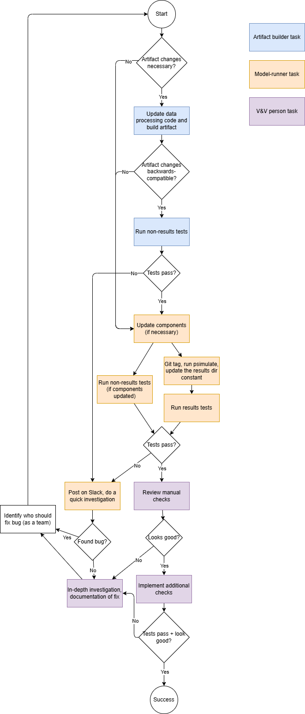

===============================
vivarium_gates_mncnh
===============================

Research repository for the vivarium_gates_mncnh project.

.. contents::
   :depth: 1

Installation
------------

The project environment is a ``.venv`` directory in your checkout, built by
`uv <https://docs.astral.sh/uv/>`_ from the committed ``uv.lock``.
Every checkout and worktree gets its own ``.venv``, with exactly the versions in
the lock. Install uv once::

  :~$ curl -LsSf https://astral.sh/uv/0.13.6/install.sh | sh

Clone the repository and set up the environment::

  :~$ git clone https://github.com/ihmeuw/vivarium_gates_mncnh.git
  :~$ cd vivarium_gates_mncnh
  :~$ source environment.sh

``source environment.sh`` builds or updates ``.venv`` from ``uv.lock``
(``uv sync --locked``) and activates it. Run it again whenever you switch
branches or pull; when nothing has changed it takes about a second.
Pass ``-f`` to reinstall every package, or ``-h`` for help.
To deactivate the environment, run ``deactivate``.

We do not support ``uv run`` for this repository, and it may behave in ways
you do not expect. For example, a plain ``uv run`` updates ``uv.lock`` when it
does not match ``pyproject.toml``, where ``source environment.sh`` and
``make build-env`` stop.

``make`` targets (``make lint``, ``make test-all``, ...) run in ``.venv``
whether or not it is active.

To change dependencies, edit ``pyproject.toml``, run ``make lock-versions``,
and commit ``uv.lock``. ``make upgrade-versions`` moves every locked version
to the newest that fits ``pyproject.toml``; ``make upgrade-versions package=<name>``
moves just one. If ``source environment.sh`` says the lock is out of date,
run ``make lock-versions`` and commit ``uv.lock``.

**Testing an unreleased framework change.** On a branch, point the package at a
git commit in the ``[tool.uv.sources]`` table of ``pyproject.toml``, then run
``make lock-versions`` and ``source environment.sh``::

  [tool.uv.sources]
  vivarium-public-health = { git = "https://github.com/ihmeuw/vivarium-suite.git", rev = "<commit>", subdirectory = "libs/public-health" }

Such a source must never reach main, and a check fails any pull request into main
that has a git or path source. Before merging, release the framework change,
require that release in ``[project] dependencies``, delete the source, and run
``make lock-versions`` again.

**Moving an existing checkout to uv.** Older checkouts have a ``.venv``
directory that holds venv overlays on the shared environments
(``.venv/vivarium_gates_mncnh*``). uv cannot use it, and ``source environment.sh``
stops and prints the command to remove it::

  :~$ rm -rf .venv
  :~$ source environment.sh

If you used the old ``-l`` option, ``source environment.sh`` also prints the
command to remove the Git LFS hooks it left in ``.git/hooks``.
The old conda environments are no longer used. Remove them with::

  :~$ conda env remove -n vivarium_gates_mncnh_simulation
  :~$ conda env remove -n vivarium_gates_mncnh_artifact

``vivarium_gbd_access`` 8.0.0 removes the ``input_data.cache_data`` setting.
If your ``~/vivarium.yaml`` sets it, every GBD pull fails with
"The 'input_data.cache_data' setting has been removed".
Remove that line from the file.

Supported Python versions: 3.11

uv installs the Python version in ``.python-version``, so you do not need
Python installed yourself.

The ``(vivarium-gates-mncnh)`` that precedes your shell prompt will probably show
up by default, though it may not.  It's just a visual reminder that you
are installing and running things in an isolated programming environment
so it doesn't conflict with other source code and libraries on your
system.

Usage
-----

You'll find six directories inside the main
``src/vivarium_gates_mncnh`` package directory:

- ``artifacts``

  This directory contains all input data used to run the simulations.
  You can open these files and examine the input data using the vivarium
  artifact tools.  A tutorial can be found at https://vivarium.readthedocs.io/en/latest/tutorials/artifact.html#reading-data

- ``components``

  This directory is for Python modules containing custom components for
  the vivarium_gates_mncnh project. You should work with the
  engineering staff to help scope out what you need and get them built.

- ``data``

  If you have **small scale** external data for use in your sim or in your
  results processing, it can live here. This is almost certainly not the right
  place for data, so make sure there's not a better place to put it first.

- ``model_specifications``

  This directory should hold all model specifications and branch files
  associated with the project.

- ``results_processing``

  Any post-processing and analysis code or notebooks you write should be
  stored in this directory.

- ``tools``

  This directory hold Python files used to run scripts used to prepare input
  data or process outputs.

When performing merges in this repository, due to the presence of notebooks, there may be conflicts more often than you expect.
The project environment has ``nbdime`` installed, which makes these conflicts easier to resolve.
Simply open the conflicting notebooks in a notebook editor (e.g. JupyterLab or VS Code) and resolve the conflicts within that interface.

Running Simulations
-------------------

You will need to repeat the entire process documented here for each location you want to run for.
Only Pakistan, Nigeria, and Ethiopia are supported currently.
In all commands here, we use Pakistan as an example;
replace "Pakistan" with the name of the location of interest.
Run every command in this section in the project environment (see Installation).

To run this simulation, the first step is to analyze GBD data to generate "caps" (maximum values)
for relative risks of low birthweight and short gestation (LBWSG).
Note that this takes a while to run (about an hour).
If you don't want to re-generate the RR caps, you can skip this step and simply use the pre-generated
files included in this repo.
Generating the caps is achieved with:::

  (vivarium-gates-mncnh) :~$ python src/vivarium_gates_mncnh/data/lbwsg_rr_caps/generate_caps.py -l Pakistan -o src/vivarium_gates_mncnh/data/lbwsg_rr_caps/caps/

The next step is to build the artifact and the LBWSG population-attributable
fractions (PAFs) that go into it.
This will only work on the IHME cluster, because it pulls draw-level data from internal
GBD databases and runs the PAF simulations with ``psimulate``.
``run_paf_sim.py`` does all of it, in five phases:
it builds an artifact with base GBD data, runs a simulation for early neonatal PAFs,
updates the artifact with them, runs a simulation for late neonatal PAFs and preterm
prevalence, and updates the artifact again::

  (vivarium-gates-mncnh) :~$ python src/vivarium_gates_mncnh/data/lbwsg_paf/code/run_paf_sim.py -l Pakistan -o artifacts/

``-o`` is the directory for ``pakistan.hdf``; use ``-a <name>`` instead to write to
``/mnt/team/simulation_science/pub/models/vivarium_gates_mncnh/artifacts/<name>``.
Leave out ``-l`` to run every location.
The PAF simulations write the calculated PAFs and preterm prevalence into
``src/vivarium_gates_mncnh/data/lbwsg_paf/outputs/``, which is tracked in git, and the
last phase builds them into the artifact.
If a phase fails, fix the cause and continue from that phase with ``--from <phase>``;
the script prints the exact command.
To rebuild only some artifact keys later, run ``make_artifacts`` yourself::

  (vivarium-gates-mncnh) :~$ make_artifacts -vvv -l "Pakistan" -o artifacts/ -r cause.neonatal_preterm_birth.prevalence

You are now ready to run the main simulation with::

  (vivarium-gates-mncnh) :~$ simulate run -vvv src/vivarium_gates_mncnh/model_specifications/model_spec.yaml -i artifacts/pakistan.hdf -o sim_results/

Results of the simulation will be written to ``sim_results/``.
For example, you can check the total deaths due to maternal disorders by
summing the ``value`` column in the Parquet file at
``sim_results/pakistan/<timestamp>/results/maternal_disorders_burden_observer_disorder_deaths.parquet``.

V&V process
-----------

We do not merge changes to the **main** branch until they have passed verification and validation (V&V).
Other branches, such as epic branches, can be merged to without V&V; only code review is required.
The reasoning for this is that V&V is quite a bit more involved than typical software testing, and may involve multiple people.
We make separate branches and pull requests for each *person's* contribution, so that their code can be reviewed by others.

Note that we may sometimes run and V&V models we do *not* intend to merge, e.g. sensitivity analyses or experiments. In that case,
we would still follow this process to ensure we did the experiment correctly, then simply close the PRs without merging once the process is complete.

The V&V process is performed through our ``pytest`` suite.
The test suite contains some tests that run the simulation (using ``vivarium.interactive.Simulation``),
and other tests that perform checks on the results of an already-run simulation (run with ``psimulate``).
Currently, some of these tests are in Python files, and some are in notebooks.
In the notebooks, there are also some checks which are not ``assert`` statements,
but require manual review of the notebook outputs to confirm that they are correct.
When notebook tests are run, the notebook outputs are saved to the ``executed`` subdirectories,
and must be committed to the repo.

The Python tests and the notebook tests run in the same environment, ``.venv``.
The notebook tests are slow, so they only run with ``pytest --runslow``.
They register a Jupyter kernel for the Python interpreter that runs ``pytest``,
so activate ``.venv`` before you run ``pytest``.

In general, for each V&V process, there are four roles to play: the artifact-builder, the component-updater, the model-runner, and the V&V person.
The artifact-builder makes the changes to the artifact,
the component-updater makes any necessary changes to the components,
the model-runner runs the model,
and the V&V person does the final sign-off that the model is working as expected.
We **require** the model-runner and V&V person to be two separate people,
and the artifact-builder and V&V person to be two separate people, but besides that one person can wear multiple "hats."
Historically, the artifact-builder, component-updater, and model-runner have been engineers,
and the V&V person has been a researcher.
With task shifting, we are now primarily having folks on the research side take on the role of artifact-builder,
and sometimes also model-runner.
The model-runner is generally the same person as the artifact-builder if no component changes are needed,
or the same person as the component-updater if component changes are needed, but we haven't yet completely formalized this.

It is encouraged to keep non-main branches up to date with main, and to merge the latest changes from main
before doing the V&V process on a branch.
However, in the case that parallel development results in V&V on a branch being done without changes that are merged to main before that branch is,
V&V should be repeated once the branch is updated with the latest changes from main.

Anytime the V&V process hands from one person (not role) to another, and code changes must be made,
the person receiving the handoff should create a new branch off of the last branch, and make a pull request for that branch.
This way each PR contains only the changes made by one person, and the others can review.

If a bug is found, the process re-starts in a new branch.
The person best-positioned to fix the bug is identified according to the nature of the bug,
and they become the artifact-builder and/or component-updater (depending on where the bug is) for the next iteration.
The V&V person does not change.

If no issues are found, the V&V person gives their sign-off that the branch is ready to be merged to main.
At this point *all* branches involved may be merged to main (if they've been code-reviewed), in whatever
order is most convenient according to potential merge conflicts and who would be better placed to resolve them.

The process works as follows:

Additional details on individual tasks follow.

**Update data processing code and build artifact**

* Build the artifact to a directory named descriptively using words rather than a model number (which has not yet been assigned).
* Be sure to update the model specification to point to the new artifact location.

**Artifact changes backwards compatible?**

This question asks whether or not we expect that existing tests should pass with the new artifact,
without any changes to the simulation itself.
In general, the answer should be "yes" when artifact updates do not change the *structure* or *meaning* of existing keys.
Or in other words, when the only component changes you anticipate needing are adding *new* functionality,
rather than changing existing functionality.

**Git tag, run psimulate, update the model results dir constant**

Because V&V involves saving outputs to the shared drive, we number all model runs
and make the shared drive directories correspond to these numbers.

We do not assign the model number until just before running the simulation.
The model number must be of the form X.Y.Z[a] and should be unique, and strictly *after*
any other model number which is a git ancestor of it.
The [a] part indicates that a model may end with a letter, e.g. 21.0.1b.
The letter is *only* used when the model is a sensitivity analysis or experiment that should *not* be merged into main,
and it *must* be used in such cases to clearly differentiate these.
In order to track how these numbers map to git revisions, we tag
the git revision just before running the simulation with the model number.
The directory where the artifact has been stored (named using words) should be
renamed to match the model number, and the update to the artifact path committed to the model spec file, before starting runs.

When running ``psimulate``, the output directory should be set to a directory named with the model number.
The MODEL_RESULTS_DIR constant in ``src/vivarium_gates_mncnh/constants/paths.py``
should be updated to reflect the new directory where results are being written,
so that the tests will be checking the correct results.
Also, the model run should be tracked on the `MNCNH run tracker <https://uwnetid.sharepoint.com/:x:/s/ihme_simulation_science_team/ERyWpil0FLNDl4wfiEOns1EBnTbGctKsKzSKY_iKDTOmxw>`__.

**Post on Slack, do a quick investigation**

The person who encounters the test failure should post on Slack right away, then do a quick investigation into why the tests are failing,
time-boxed to 15 minutes.
If this does not identify a bug, the issue will be escalated to the V&V person.
